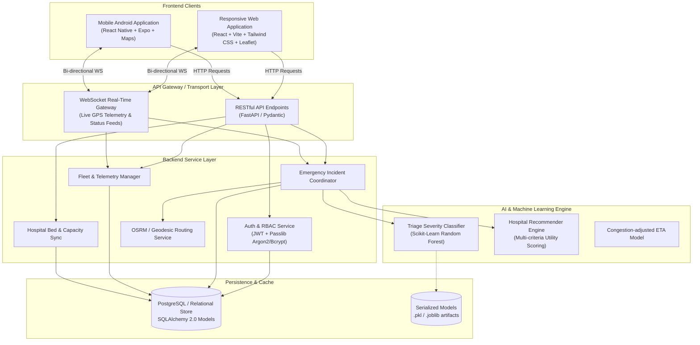
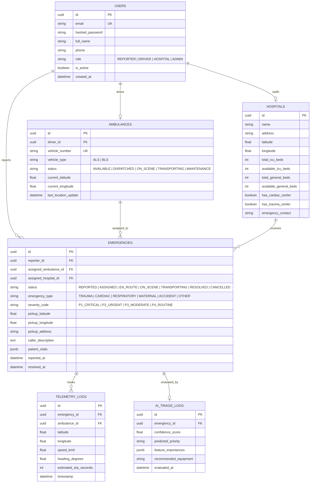
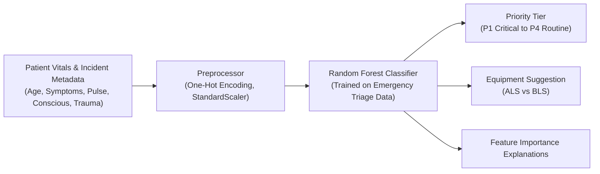

# System Architecture & Technical Specifications
## AI-Based Emergency Response & Ambulance Routing System

---

### 1. High-Level System Architecture



---

### 2. Monorepo Structural Breakdown

```
Ambulance/
├── .gitignore                      # Monorepo-wide ignore definitions
├── README.md                       # Master presentation & quick start guide
├── docs/                           # Architecture, milestones, interview guides
│   ├── PROJECT_OVERVIEW.md         # Problem statement, roles & feature matrix
│   ├── ARCHITECTURE.md             # In-depth system design & data schemas
│   └── MILESTONES.md               # Strict execution roadmap & checklists
├── web/                            # React + Vite Web Portal
│   ├── src/
│   │   ├── components/             # Reusable UI (Navbar, Modal, LeafletMap, etc.)
│   │   ├── contexts/               # AuthContext, EmergencyContext, WebSocketContext
│   │   ├── pages/                  # Role-based pages:
│   │   │   ├── reporter/           # Patient / Citizen SOS Dashboard
│   │   │   ├── driver/             # Driver Navigation & Task Dashboard
│   │   │   ├── hospital/           # ER Staff Incoming Queue & Bed Manager
│   │   │   └── admin/              # Control Room Fleet Command Center
│   │   ├── services/               # API clients (Axios) & Mock Data Services
│   │   ├── types/                  # Type / JSDoc model contracts
│   │   ├── utils/                  # Coordinate math, date formatters, geo-helpers
│   │   ├── App.jsx                 # Dynamic routing & RBAC protection
│   │   └── main.jsx
│   ├── package.json
│   ├── tailwind.config.js
│   └── vite.config.js
├── mobile/                         # React Native + Expo Android App
│   ├── src/
│   │   ├── navigation/             # Role-based Tab & Stack Navigators
│   │   ├── screens/                # Mobile equivalents for Reporter & Driver
│   │   ├── components/             # Mobile Cards, Custom Map Pins, SOS Trigger
│   │   └── services/               # Mobile API and location tracker
│   ├── app.json
│   └── package.json
├── backend/                        # FastAPI Backend Application
│   ├── app/
│   │   ├── api/
│   │   │   ├── v1/                 # Versioned REST route controllers
│   │   │   │   ├── auth.py
│   │   │   │   ├── emergencies.py
│   │   │   │   ├── ambulances.py
│   │   │   │   ├── hospitals.py
│   │   │   │   └── ml_endpoints.py
│   │   │   └── websockets/         # WebSocket connection manager & broadcast
│   │   ├── core/                   # Security, JWT tokens, config & settings
│   │   ├── db/                     # SQLAlchemy engine, base & session lifecycle
│   │   ├── models/                 # SQLAlchemy ORM database models
│   │   ├── schemas/                # Pydantic input/output validation models
│   │   └── services/               # Dispatch algorithms, geo calculations
│   ├── requirements.txt
│   └── main.py
├── ml/                             # Machine Learning Research & Pipeline
│   ├── data/                       # Synthetic & benchmark emergency datasets
│   ├── notebooks/                  # EDA, model training & evaluation notebooks
│   ├── src/                        # Feature engineering, training & inference code
│   └── models/                     # Exported model weights (.joblib)
```

---

### 3. Database Entity-Relationship Model (ERD)



---

### 4. Real-Time Telemetry & WebSocket Protocol

To achieve smooth tracking without heavy server load, WebSockets operate with a topic-based Connection Manager:

- **Channels / Rooms:**
  - `admin:fleet` — Receives all ambulance coordinate pulses and emergency state transitions.
  - `emergency:{emergency_id}` — Streamed to the patient reporter, the assigned driver, and the receiving hospital.
- **Message Payload Format:**
```json
{
  "event": "LOCATION_UPDATE",
  "emergency_id": "8b03e2c6-3bf4-49ab-bfad-833eec185a42",
  "ambulance_id": "amb-04",
  "coordinates": {
    "latitude": 12.9716,
    "longitude": 77.5946
  },
  "speed_kmh": 48.5,
  "heading": 135.0,
  "eta_minutes": 8.4,
  "status": "TRANSPORTING",
  "timestamp": "2026-10-13T17:40:00Z"
}
```

---

### 5. AI/ML Subsystem Specification



- **Feature Space:**
  - `age`: integer (0 - 100)
  - `systolic_bp`: integer (60 - 220)
  - `heart_rate`: integer (30 - 200)
  - `oxygen_saturation`: integer (50 - 100)
  - `consciousness_level`: categorical (`ALERT`, `VERBAL`, `PAIN`, `UNRESPONSIVE` - AVPU scale)
  - `severe_bleeding`: boolean (0 / 1)
  - `chest_pain`: boolean (0 / 1)
  - `incident_category`: categorical (`FALL`, `TRAFFIC_COLLISION`, `CARDIAC`, `RESPIRATORY`, `BURN`, `ASSAULT`)

- **Dispatch Matching Formula:**
  $$\text{MatchScore}(A) = 0.6 \cdot \frac{1}{\text{Distance}(A, \text{Incident}) + 0.1} + 0.4 \cdot \mathbb{I}_{\text{Tier Match}}(A)$$

---

### 6. Authentication, Security & RBAC

1. **Password Hashing:** Passlib with Argon2 / Bcrypt with configurable cost factor.
2. **Access Tokens:** Short-lived JWTs (30 minutes expiry) containing:
   - `sub`: User UUID
   - `role`: Role string (`REPORTER`, `DRIVER`, `HOSPITAL`, `ADMIN`)
   - `exp`: Expiration timestamp
3. **Role Enforcement Decorators:** FastAPI dependencies `get_current_active_user` and `require_role(["ADMIN", "DRIVER"])` protect critical dispatch and bed update endpoints.
4. **CORS & Environment Isolation:** Secure origin whitelisting allowing only web client (`localhost:5173`) and mobile Expo runtime (`localhost:8081` / LAN IPs).
